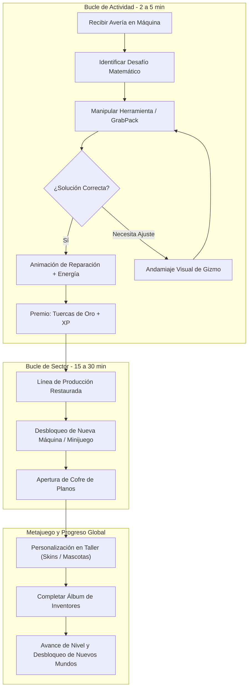

# GAME DESIGN DOCUMENT (GDD) - FÁBRICA DE MATES
**Versión:** 1.0.0  
**Fecha:** Noviembre 2026  
**Estado:** Fase 1 - Propuesta de Producción  
**Equipo Responsable:** Equipo Multidisciplinar Fábrica de Mates (Lead Game Designer, Experto en Gamificación, Psicopedagogo 3-12 años, UX/UI Designer Infantil, Frontend Senior, Mobile App Architect, Especialista en Accesibilidad, Diseñador de Juegos Educativos, Full Stack Architect, Product Manager Educativo).

---

## 1. FICHA TÉCNICA Y VISIÓN DEL PRODUCTO

### 1.1. Información General
* **Título Oficial:** Fábrica de Mates (Math Factory: Energy Workshop)
* **Género:** Plataforma Educativa Gamificada / Puzzle-Aventura de Gestión y Reparación
* **Público Objetivo Principal:** Niños y niñas de 3 a 12 años (dividido en 7 tramos psicopedagógicos desde Educación Infantil hasta 6º de Primaria / 1º ESO).
* **Público Objetivo Secundario:** Familias (padres/tutores) y Comunidad Docente (colegios, academias, centros de refuerzo).
* **Plataformas de Despliegue:** 
  * Web Responsive (Chrome, Safari, Firefox, Edge).
  * PWA (Progressive Web App con soporte offline completo mediante Service Workers e IndexedDB).
  * Tablets & Smartphones (iPadOS, iOS, Android Tablets, Android Phones).
  * Entornos de aula (Chromebooks, Pizarras Digitales Interactivas).
* **Modelo de Negocio / Ética:** 
  * **CERO microtransacciones con dinero real.** 
  * Sin anuncios de terceros ni publicidad invasiva.
  * Cumplimiento estricto de **COPPA, GDPR-K, FERPA** y leyes de protección de datos de menores.
  * Licencias institucionales B2B para colegios y suscripción familiar ética (opcional en capas avanzadas).

### 1.2. Misión y Propósito
Transformar el aprendizaje matemático en una aventura mecánica y tangible. Las matemáticas dejan de ser un conjunto de símbolos abstractos sobre una hoja de papel para convertirse en el **combustible y los engranajes** que mantienen viva la fábrica de juguetes más asombrosa del mundo. Cada operación resuelta repara un circuito, equilibra una caldera de vapor o programa un autómata.

---

## 2. FUNDAMENTACIÓN PSICOPEDAGÓGICA Y NEUROEDUCACIÓN

El diseño de *Fábrica de Mates* se apoya en cuatro pilares científicos del desarrollo cognitivo infantil:

```
                  ┌─────────────────────────────────────┐
                  │    MÉTODO C-P-A (BRUNER / SINGAPUR) │
                  │  Concreto ➔ Pictórico ➔ Abstracto   │
                  └──────────────────┬──────────────────┘
                                     │
                  ┌──────────────────▼──────────────────┐
                  │   ZONA DE DESARROLLO PRÓXIMO (ZDP)   │
                  │       Andamiaje Dinámico por IA      │
                  └──────────────────┬──────────────────┘
                                     │
                  ┌──────────────────▼──────────────────┐
                  │     ERRADICACIÓN DE LA ANSIEDAD     │
                  │   Sin timers punitivos ni castigos  │
                  └──────────────────┬──────────────────┘
                                     │
                  ┌──────────────────▼──────────────────┐
                  │     APRENDIZAJE SIGNIFICATIVO       │
                  │    Mecánica lúdica = Concepto mate  │
                  └─────────────────────────────────────┘
```

### 2.1. El Método C-P-A (Concreto, Pictórico, Abstracto)
Inspirado en Jerome Bruner y el método Singapur de matemáticas:
1. **Nivel Concreto:** Manipulación virtual de objetos tangibles (tuercas, bloques de energía, cajas, pistones).
2. **Nivel Pictórico:** Representación de cantidades mediante diagramas de barras, cuadrículas de decenas, cintas de longitud y gráficos visuales.
3. **Nivel Abstracto:** Expresión formal simbólica ($3 + 4 = 7$, $\frac{1}{2}$, incógnitas $x$).
*Regla de diseño:* Ningún concepto nuevo se presenta de forma puramente abstracta. Siempre se transiciona desde lo visual y manipulativo hacia lo numérico.

### 2.2. Zona de Desarrollo Próximo (Vygotsky) y Teoría del Flujo (Csikszentmihalyi)
* El juego monitorea en tiempo real la tasa de éxito y el tiempo de indecisión.
* Si el jugador experimenta frustración (2 fallos continuos), el sistema **despliega andamiaje visual** (ej: activa guías de color para decenas y centenas, casillas de llevadas automáticas, descomposición visual).
* Si el jugador muestra aburrimiento o dominio inmediato (5 aciertos ultrarrápidos), la IA incrementa el reto (quita andamiajes visuales, añade incógnitas intermedias o activa problemas de lógica combinada).

### 2.3. Erradicación de la "Ansiedad Matemática" (Math Anxiety)
* **Feedback Libre de Castigo:** Un fallo nunca reproduce sonidos estridentes, pantallas rojas ni pérdida de vidas/progreso. Un fallo es simplemente una *"máquina que tose vapor"* o un cable que chisporrotea amigablemente: *"¡Casi! Necesitamos 2 amperios más, prueba a revisar las decenas"*.
* **Sin cronómetros angustiosos:** Las mecánicas con tiempo (ej: cinta transportadora) nunca destruyen al jugador si el tiempo acaba; la caja simplemente da otra vuelta por la cinta o el robot ayudante frena la cinta suavemente para dar tiempo a pensar.

---

## 3. NARRATIVA, PERSONAJES Y DIRECCIÓN DE ARTE

### 3.1. La Historia Principal
En el corazón del Valle Mecánico se encuentra **La Fábrica de Mates**, una portentosa industria encargada de fabricar los juguetes más fantásticos del universo. Esta fábrica funciona gracias a una fuente limpia e infinita: la **Energía Matemática**, generada por la perfecta sincronía de números, simetrías y ecuaciones.

Una mañana, un travieso tornillo flojo provocó el **"Gran Descalibre"**: las máquinas mezclaron sus configuraciones, las cintas transportadoras cambiaron de dirección y los robots guardianes quedaron en modo reposo. 

El jugador asume el rol del **Nuevo Ingeniero/a Jefe**. Acompañado por el **GrabPack Multiuso** (una mochila con manos extensibles magnéticas inspirada en la ingeniería de juguetes) y un entrañable equipo de robots, deberá recorrer los 7 departamentos de la fábrica, calibrar los circuitos y devolver la luz y la alegría a la producción.

### 3.2. Personajes y Arquetipos

| Personaje | Rol en el Juego | Personalidad y Función Pedagógica |
| :--- | :--- | :--- |
| **Gizmo** | Robot Asistente Principal | Pequeño dron rodante con pantalla emotiva. Es el tutor socrático: nunca da la respuesta directa, ofrece analogías y pistas constructivas. |
| **Tuerca & Tornillo** | Dúo de Mecanoides Cómicos | Dos pequeños ayudantes que demuestran visualmente las llevadas y los préstamos pasando bloques físicos de una columna a otra. |
| **Robo-Chef Pi** | Autómata de Fracciones | Encargado del sector de moldes y particiones. Enseña equivalencias usando pizzas metálicas, barras de chocolate de juguete y depósitos de pintura. |
| **El Jugador/a** | Avatar Personalizable | Aprendiz que evoluciona desde "Aspirante a Mecánico" hasta "Maestro Arquitecto Cuántico". |

### 3.3. Dirección de Arte y Estética
* **Inspiración:** Cruce visual entre la atmósfera industrial de fantasía de *Playtime Co.* (juguetería vintage, cables neón, maquinaria retro-futurista), el acabado pulido y acogedor de *Nintendo (Mario Maker / Kirby)* y la claridad pedagógica de *Khan Academy Kids*.
* **Paleta Cromática:** 
  * Fondo: Azul marino profundo e índigo industrial (`#070C1F`, `#0A1330`) que previene la fatiga visual.
  * Acentos Neón Amigables: Azul Eléctrico (`#19A7FF`), Rosa Neón (`#FF3FA4`), Amarillo Energía (`#FFD23F`), Verde Reparación (`#2DFF7A`).
* **Tipografía:** *Baloo 2* y *Quicksand*. Caracteres redondeados, familiares, con excelente distinción entre números confusos (como 1, 7, 6 y 9).

---

## 4. CORE GAMEPLAY LOOP Y METASISTEMAS



### 4.1. El Bucle Primario (Micro-Loop)
1. **Detección de la Avería:** Se presenta una máquina detenida (ej: una compuerta neumática cerrada porque la presión en unidades y decenas no coincide).
2. **Interacción Tangible:** El niño utiliza herramientas táctiles (manos del GrabPack, perillas giratorias, conectores de cables, sellos numéricos).
3. **Resolución y Refuerzo Inmediato:** Al acertar, la máquina arranca con efectos de luz, engranajes girando y sonido de vapor triunfal. Se otorgan **Tuercas de Oro** y **Energía Matemática**.

### 4.2. El Bucle Secundario (Meso-Loop)
* Cada mundo consta de 5 a 10 líneas de montaje averiadas.
* Reparar una línea completa desbloquea un minijuego de bonificación (ej: carrera de vagonetas o puzle de tuberías).
* Al terminar un sector, se rescata a un **Robot Guardián** que pasa a formar parte del taller del jugador.

### 4.3. El Metajuego (Macro-Loop)
* **El Taller del Jugador:** Una sala personalizable donde el niño exhibe sus trofeos, robots reparados y decora las paredes con herramientas y pegatinas.
* **Álbum de la Fábrica:** Cromos coleccionables digitales que se consiguen completando hitos educativos, con biografías ilustradas de científicas y matemáticos de la historia.
* **Pase de Temporada Educativo ("Plan de Obras"):** Progreso por niveles sin tiempo límite (no FOMO), donde cada nivel otorga skins para el GrabPack o nuevos peinados/uniformes para el avatar.

---

## 5. ESTRUCTURA PEDAGÓGICA DE LOS 7 MUNDOS

```
┌───────────────────────────────────────────────────────────────────────────┐
│                           LOS 7 MUNDOS DE LA FÁBRICA                      │
├───────┬───────────────────────────────┬────────────┬──────────────────────┤
│ Mundo │ Nombre del Sector             │ Edad       │ Foco Matemático      │
├───────┼───────────────────────────────┼────────────┼──────────────────────┤
│ M1    │ Sala de Números               │ 3-5 años   │ Conteo, Grafía, Orden│
│ M2    │ Central de Sumas              │ 5-7 años   │ Sumas Visuales y Llev│
│ M3    │ Laboratorio de Restas         │ 6-8 años   │ Restas y Préstamos   │
│ M4    │ Taller Multiplicador          │ 7-9 años   │ Tablas, Matrices, Pat│
│ M5    │ Departamento de División      │ 8-10 años  │ Repartos, Fraccionam.│
│ M6    │ Centro de Fracciones          │ 9-11 años  │ Fracciones y Decimal.│
│ M7    │ Ingeniería Matemática         │ 10-12 años │ Lógica, Ecuaciones   │
└───────┴───────────────────────────────┴────────────┴──────────────────────┘
```

### Mundo 1: Sala de Números (Infantil / 3 a 5 años)
* **Objetivos Curriculares:** Reconocimiento de grafías del 1 al 20, correspondencia uno a uno, ordenación ascendente y descendente, comparación de cantidades (mayor que, menor que, igual), figuras geométricas básicas.
* **Ambientación:** Zona de clasificación de piezas blandas, juguetes de madera, luces de colores pastel y cintas de gomaespuma.

### Mundo 2: Central de Sumas (1º - 2º Primaria / 5 a 7 años)
* **Objetivos Curriculares:** Descomposición del número 10 (amigos del 10), sumas de 1 dígito en horizontal, paso a suma vertical de 2 y 3 cifras con soporte de casillas de llevada visual interactiva.
* **Ambientación:** Generadores eléctricos de neón, baterías recargables por acumulación de voltios, conectores del GrabPack.

### Mundo 3: Laboratorio de Restas (2º - 3º Primaria / 6 a 8 años)
* **Objetivos Curriculares:** Restas como diferencia y como retroceso en la recta numérica. Restas verticales con préstamos/llevadas explicadas mediante descomposición de decenas en 10 unidades físicas.
* **Ambientación:** Cintas transportadoras, brazos mecánicos desarmadores, compuertas de descarga de presión de vapor.

### Mundo 4: Taller Multiplicador (3º - 4º Primaria / 7 a 9 años)
* **Objetivos Curriculares:** La multiplicación como suma repetida y como matriz rectangular (filas x columnas). Comprensión visual y memorización comprensiva de las tablas del 1 al 10. Patrones y múltiplos.
* **Ambientación:** Matrices de ensamblaje en cuadrícula, engranajes multiplicadores de velocidad, duplicadores de cajas de juguetes.

### Mundo 5: Departamento de División (4º - 5º Primaria / 8 a 10 años)
* **Objetivos Curriculares:** División como reparto equitativo y como agrupamiento en partes iguales. Concepto de cociente y resto visual. División por 1 y 2 cifras.
* **Ambientación:** Tolvas clasificadoras, balanzas de dos brazos, empaquetado de pedidos en cajas de tamaño idéntico.

### Mundo 6: Centro de Fracciones y Decimales (5º - 6º Primaria / 9 a 11 años)
* **Objetivos Curriculares:** Fracción como parte de un todo y como operador. Fracciones equivalentes, comparación, suma y resta con igual y distinto denominador. Introducción al número decimal y porcentajes sencillos.
* **Ambientación:** Depósitos de pintura líquida graduada, cortadoras láser de placas de metal, prensas dosificadoras de precisión.

### Mundo 7: Ingeniería Matemática (6º Primaria - 1º ESO / 10 a 12 años)
* **Objetivos Curriculares:** Jerarquía de operaciones, ecuaciones sencillas de primer grado con incógnita visual ($x$), cálculo de perímetros y áreas, pensamiento computacional y problemas de lógica deductiva multietapa.
* **Ambientación:** La Sala Central de Computación, reactores de fusión matemática, terminales lógicas de fibra óptica y circuitos de algoritmos.

---

## 6. CATÁLOGO COMPLETO DE 105 MINIJUEGOS ÚNICOS

Para cumplir la especificación de **más de 100 minijuegos sin repetir exactamente la misma mecánica**, se estructuran **15 minijuegos por cada uno de los 7 mundos**, abarcando las 8 tipologías exigidas (Puzzles, Construcción, Exploración, Plataformas, Cartas, Memoria, Carreras y Misiones):

### 6.1. Mundo 1: Sala de Números (15 Minijuegos)
1. **El Cosechador de Engranajes (Misión / Conteo):** Recoger exactamente el número de engranajes que marca el letrero con la mano magnética.
2. **Torre de Bloques Numéricos (Construcción):** Apilar bloques del 1 al 5 en orden de tamaño para alcanzar una bombilla averiada.
3. **El Escáner de Siluetas (Puzzle / Formas):** Encajar formas geométricas en la matriz de la prensa de juguetes.
4. **Camino de Huellas Luminosas (Exploración / Secuencias):** Pisar las baldosas que siguen la serie numérica $1, 2, 3...$ para cruzar un pasillo oscuro.
5. **Vagón de Peluches (Memoria / Cantidad):** Observar cuántos peluches entran en la caja antes de que se cierre la tapa y seleccionar el número correspondiente.
6. **Balancín de Juguetes (Puzzle / Comparación):** Colocar juguetes en un balancín hasta que ambos lados tengan el mismo peso visual.
7. **Carrera de Cuerdas (Carreras / Orden):** Impulsar carritos tirando de la cuerda que tiene el número mayor.
8. **Plataformas Salta-Números (Plataforma):** Hacer saltar al robot solo sobre plataformas con números pares o impares simples.
9. **Duelo de Cartas Gigantes (Cartas / Reconocimiento):** Voltear cartas y emparejar la cifra escrita ("4") con su grupo de 4 tuercas.
10. **Trazado de Neón (Misión / Grafomotricidad):** Guiar la chispa eléctrica con el dedo siguiendo el trazo correcto de los números del 0 al 9.
11. **Tuberías de Patos (Puzzle / Dirección):** Conectar tuberías numeradas en orden ascendente para llenar la bañera de pruebas.
12. **El Contador de la Cinta (Exploración / Agilidad Visual):** Pulsar el botón verde cada vez que pase un juguete de color rojo por la cinta.
13. **Inspector de Faltas (Puzzle / Número Perdido):** Identificar qué vagón del tren de números falta en la serie: $1, 2, \text{¿?}, 4$.
14. **Construye tu Mascota (Construcción / Partes):** Ensamblar un perro robot usando 1 cabeza, 4 patas y 1 cola según la receta.
15. **La Diana de la Fábrica (Misión / Puntería):** Lanzar dardos de ventosa al número que pronuncia Gizmo por voz.

### 6.2. Mundo 2: Central de Sumas (15 Minijuegos)
16. **El GrabPack de las Sumas (Misión / Operación Vertical):** Resolver sumas de 2 y 3 cifras conectando las manos roja y azul a los terminales correctos (heredado y evolucionado del MVP 0.1).
17. **Los Amigos del 10 (Puzzle / Combinación):** Unir conectores de baterías cuyas cargas sumen exactamente 10 para restaurar un panel.
18. **La Caldera de Presión (Plataforma):** Ajustar válvulas sumando bares de presión para que la plataforma de vapor suba al piso deseado.
19. **Cinta Transportadora de Paquetes (Carreras / Tiempo Adaptado):** Seleccionar la caja con el resultado de la suma antes de que llegue a la empaquetadora.
20. **Memoria de Baterías (Memoria / Equivalencia):** Emparejar operaciones con su resultado correcto ($15 + 8$ con $23$).
21. **Puente de Ladrillos Magnéticos (Construcción):** Sumar longitudes de vigas para tender un puente del largo exacto del abismo.
22. **El Laberinto de Cables (Exploración):** Seguir el cable cuyos empalmes sumen el valor total de la puerta de seguridad.
23. **Guerra de Fichas Eléctricas (Cartas):** Juego estilo "Top Trumps": lanzar cartas de sumas; la suma de mayor valor gana la mano.
24. **Ascensor Hidráulico (Misión / Recta Numérica):** Subir el ascensor sumando de 5 en 5 o de 10 en 10 pisos.
25. **El Clasificador de Monedas (Puzzle / Agrupación):** Arrastrar monedas de 1, 10 y 100 a sus huchas correspondientes para completar la cifra meta.
26. **Reparación del Generador (Puzzle / Casillas de Llevada):** Activar manualmente los círculos de llevada en las decenas para que el motor arranque.
27. **Carrera de Drones (Carreras):** Acelerar el dron respondiendo sumas de cálculo mental rápido en bifurcaciones del circuito.
28. **El Enigma de la Caja Fuerte (Misión / Término Faltante):** Descubrir el número que falta en la combinación: $34 + \text{¿?} = 50$.
29. **Torre de Cajas Neón (Construcción / Pirámide):** Construir una pirámide numérica donde cada bloque superior es la suma de los dos inferiores.
30. **El Robot Pintor (Exploración / Color por Número):** Pintar un mural de robots calculando la suma de cada zona para saber qué bote de pintura usar.

### 6.3. Mundo 3: Laboratorio de Restas (15 Minijuegos)
31. **Escape de la Trituradora (Carreras / MVP 0.1 Mejorado):** Resolver restas verticales con préstamos antes de que las cajas de chatarra caigan a la tolva.
32. **Desarmador de Autómatas (Misión / Resta Visual):** Quitar el número exacto de piezas defectuosas de un robot usando la tenaza neumática.
33. **La Báscula de Restas (Puzzle / Equilibrio):** Restar contrapesos de un platillo para equilibrar la báscula de calibración.
34. **Descarga de Vapor (Plataforma):** Abrir compuertas de alivio restando la presión excedente para permitir el paso del avatar.
35. **Túnel de Restas Subterráneo (Exploración):** Guiar la vagoneta minera restando distancias en los cruces de vías.
36. **Construye el Dique (Construcción):** Cortar tablones de madera a la medida exacta restando el sobrante.
37. **El Banco de Préstamos (Puzzle / Mecánica de Llevada):** Abrir una caja de 10 unidades cuando a la columna de las unidades "no le alcanzan" las piezas.
38. **Cartas de Descarte (Cartas):** Deshacerse de la mano de cartas jugando aquellas cuya diferencia sea igual a la carta de la mesa.
39. **Cámaras de Seguridad (Memoria):** Recordar cuántos robots había en una sala y cuántos salieron para calcular cuántos quedan dentro.
40. **El Radar de Piezas Perdidas (Misión):** Restar coordenadas cartesianas para triangular la posición de un microchip extraviado.
41. **Frenos del Tren Bala (Carreras):** Aplicar zapatas de freno restando velocidad en tramos de 50 km/h para detener el tren en el andén.
42. **El Puzle del Candado de Poppy (Puzzle / MVP 0.1):** Descifrar el candado de la vitrina calculando restas combinadas.
43. **Vaciado de Tanques (Puzzle / Volumen):** Drenar un depósito de aceite hasta el nivel óptimo mediante bombas de diferente caudal.
44. **El Reloj del Taller (Exploración / Tiempo):** Restar horas y minutos para calcular cuánto tiempo falta para el encendido general.
45. **Caza de Errores en la Pizarra (Misión):** Encontrar cuál de las tres operaciones escritas por el robot averiado contiene un error en el préstamo.

### 6.4. Mundo 4: Taller Multiplicador (15 Minijuegos)
46. **La Matriz de Galletas (Construcción / Filas x Columnas):** Hornear bandejas colocando moldes de $3 \times 4$ o $5 \times 6$ para llenar los huecos.
47. **Engranajes Sincronizados (Puzzle / Múltiplos):** Elegir la rueda dentada de 6, 8 o 12 dientes que encaje con el motor impulsor.
48. **El Clonador de Juguetes (Misión / Suma Repetida):** Ajustar la palanca del multiplicador para duplicar o triplicar una remesa de ositos.
49. **Pista de Salto Múltiplo (Plataforma):** Saltar de baldosa en baldosa siguiendo la tabla del 7 sin caer en falso.
50. **El Laberinto de las Tablas (Exploración):** Abrir compuertas magnéticas que solo aceptan múltiplos de un número específico (ej: tabla del 8).
51. **Duelo de Tablas de Neón (Cartas):** Enfrentamiento rápido de cartas: multiplicar el número propio por el del rival; el mayor producto gana.
52. **El Panel de Luces LED (Memoria / Factores):** Recordar qué dos factores ocultos en el panel dan como producto el número mostrado ($6 \times 7 = 42$).
53. **Carrera de Cohetes de Juguete (Carreras):** Impulsar el cohete respondiendo multiplicaciones con aceleradores de turbo.
54. **Empaquetado en Bloques 3D (Construcción / Volumen Inicial):** Calcular cuántas cajas caben en un contenedor multiplicando base x altura.
55. **La Torre del Mago Matemático (Puzzle):** Colocar gemas energéticas en un tótem donde cada piso multiplica el poder del anterior.
56. **El Árbol de Factores (Puzzle / Descomposición):** Ramificar un número grande (ej: 36) en sus ramas multiplicativas ($6 \times 6$, $9 \times 4$).
57. **La Orquesta de Robots (Misión / Ritmo):** Programar el golpe de percusión de los autómatas cada $3, 6, 9, 12$ pulsos de compás.
58. **El Repartidor Exprés (Exploración / Rutas):** Llevar 4 pedidos a 5 casas diferentes calculando el total de paquetes cargados.
59. **Pesca Magnética en la Charca (Misión):** Atrapar con el GrabPack solo los peces metálicos que sean múltiplos del número guía.
60. **El Gran Reloj de Múltiplos (Puzzle):** Girar las manecillas del reloj mecánico haciendo coincidir los múltiplos de 5 y 10.

### 6.5. Mundo 5: Departamento de División (15 Minijuegos)
61. **El Reparto de Galletas de Robot (Misión / Reparto Equitativo):** Distribuir 24 galletas en 4 platos sin que sobre ninguna.
62. **La Máquina Embotelladora (Puzzle / División con Resto):** Llenar cajas de 6 botellas con un lote de 26 botellas y apartar las 2 sobrantes en la zona de reserva.
63. **Cintas Divisoras de Tráfico (Carreras):** Dividir el flujo de vagonetas en 3 vías secundarias por igual para evitar colisiones.
64. **Plataformas de Peso Equitativo (Plataforma):** Cortar un bloque de chatarra en partes iguales para colocar una en cada botón de presión.
65. **El Enigma de las Taquillas (Exploración):** Hallar la llave correcta resolviendo divisiones cuyo cociente coincide con el número de taquilla.
66. **Construye el Muro de Contención (Construcción):** Saber cuántos ladrillos de tamaño 4 hacen falta para cubrir una pared de 32 metros.
67. **Cartas de Reparto Justo (Cartas):** Emparejar cartas de dividendos con su divisor y cociente correspondiente.
68. **Memoria de Restos (Memoria):** Emparejar operaciones que tienen el mismo resto (ej: $13 / 4$ y $19 / 4$, ambas con resto 1).
69. **La Grúa Clasificadora (Misión):** Levantar contenedores dividiendo el peso total entre los 4 cables de suspensión.
70. **Cálculo de Precios por Unidad (Puzzle):** Descubrir cuánto cuesta 1 tornillo sabiendo que la bolsa de 8 tornillos cuesta 40 tuercas.
71. **El Teleférico de los Mecanoides (Puzzle):** Distribuir 30 pequeños robots en cabinas de 5 en 5 para que el teleférico no se desbalancee.
72. **Carrera de Drenaje (Carreras):** Abrir las válvulas de desahogo correctas dividiendo el caudal entre los tubos de salida.
73. **El Cortador de Cables de Neón (Misión):** Medir un rollo de cable de 100 cm y cortarlo en trozos de 20 cm exactos.
74. **El Puzle del Joyero Robot (Puzzle):** Distribuir gemas de colores en cajones idénticos de manera que todos tengan la misma cantidad de cada color.
75. **Inspector de Repartos Fraudulentos (Misión / Auditoría):** Identificar qué operario ha hecho un reparto desigual en las cajas de envío.

### 6.6. Mundo 6: Centro de Fracciones y Decimales (15 Minijuegos)
76. **La Pizzería de Gizmo (Misión / Fracción de un Todo):** Cortar masas redondas en medios, cuartos y octavos según los pedidos de los robots.
77. **El Mezclador de Pintura (Puzzle / Decimales):** Mezclar $0.5$ litros de azul con $0.25$ litros de amarillo para obtener el tono exacto.
78. **Balanza de Fracciones Equivalentes (Puzzle):** Demostrar que $\frac{2}{4}$ equilibra exactamente a $\frac{1}{2}$ en la balanza de precisión.
79. **El Puente de Vigas Fraccionadas (Construcción):** Rellenar el hueco de una pasarela uniendo tramos de $\frac{1}{3} + \frac{2}{6}$.
80. **Plataforma Salta-Decimales (Plataforma):** Cruzar un lago tóxico saltando solo sobre piedras con números decimales crecientes ($0.1, 0.35, 0.7$).
81. **El Laberinto de Porcentajes (Exploración):** Encontrar la salida abriendo puertas con descuentos del 50%, 25% y 10%.
82. **Cartas de Fracciones y Gráficos (Cartas):** Emparejar el gráfico de tarta coloreado con su fracción simbólica correspondiente.
83. **Memoria de Tanques de Combustible (Memoria):** Recordar qué depósitos están llenos a $\frac{3}{4}$, $\frac{2}{5}$ y $\frac{7}{10}$.
84. **Carrera de Autos Solares (Carreras / Batería Decimal):** Recargar la batería solar alcanzando marcas exactas ($0.25, 0.50, 0.75, 1.0$).
85. **El Cortador Láser de Placas (Misión):** Configurar el rayo láser para cortar una placa de metal en quintos exactos.
86. **Suma de Barras de Energía (Puzzle):** Conectar barras de carga con distinto denominador convirtiéndolas a común denominador visual.
87. **La Báscula Digital de Monedas (Puzzle / Decimales):** Pesar bolsas de tuercas sumando kilos y gramos en formato decimal ($1.25 \text{ kg} + 0.8 \text{ kg}$).
88. **Llenado de Tubos de Ensayo (Misión):** Verter líquido hasta la marca fraccionaria pedida por el profesor autómata.
89. **El Reloj de Cuartos y Medias Horas (Exploración):** Configurar los turnos de la fábrica entendiendo las fracciones de una hora.
90. **El Descuento de la Tienda de Juguetes (Puzzle):** Calcular el precio rebajado de un muñeco que tiene un 20% de descuento.

### 6.7. Mundo 7: Ingeniería Matemática (15 Minijuegos)
91. **La Ecuación del Reactor Central (Misión / Despejar Incógnita):** Encontrar el valor de $x$ en la consola principal ($2x + 6 = 20$) para estabilizar el núcleo.
92. **El Circuito Lógico Booleano (Puzzle / Lógica):** Conectar compuertas AND/OR/NOT para que la señal eléctrica llegue a la compuerta blindada.
93. **Cálculo de Perímetros de la Cerca (Construcción):** Instalar vallas de seguridad alrededor de las áreas peligrosas calculando la suma de sus lados.
94. **La Alfombra Láser de Áreas (Puzzle):** Configurar el área de cobertura de los sensores de movimiento ($Base \times Altura$).
95. **Plataforma de Operaciones Combinadas (Plataforma):** Pisar las plataformas respetando la jerarquía matemática (primero paréntesis, luego multiplicaciones, luego sumas).
96. **El Laberinto de Algoritmos (Exploración):** Programar las instrucciones de movimiento de un robot móvil usando bucles y condiciones.
97. **Duelo de Expresiones Algebraicas (Cartas):** Jugar cartas con expresiones ($3n$, $n^2$, $n + 5$); gana quien tenga el valor más alto dado un valor secreto de $n$.
98. **Memoria de Coordenadas Cartesianas (Memoria):** Localizar cuadrantes y puntos $(X, Y)$ en el radar de la torre de control.
99. **Carrera de Trayectorias Angulares (Carreras / Ángulos):** Calibrar el ángulo de giro de la nave ($45^\circ, 90^\circ, 180^\circ$) para esquivar obstáculos.
100. **El Teorema de las Poleas (Puzzle / Razonamiento):** Equilibrar pesos usando poleas simples y dobles aplicando proporciones matemáticas.
101. **El Decodificador de Mensajes Secretos (Misión / Criptografía):** Descifrar el código binario y numérico emitido por el satélite de la fábrica.
102. **El Rompecabezas del Volumen de Tanques (Puzzle):** Calcular el volumen de agua de contenedores cilíndricos y prismáticos.
103. **El Puente Colgante de Triángulos (Construcción / Simetría):** Ensamblar cerchas triangulares rígidas calculando ángulos y simetrías axiales.
104. **El Panel de Probabilidad y Azar (Misión):** Predecir qué tolva tiene mayor probabilidad de soltar una esfera dorada ($3$ de $10$ vs $1$ de $2$).
105. **El Gran Reinicio de la Fábrica (Misión Final Multietapa):** Resolver un gran desafío cooperativo combinando cálculo mental, lógica espacial y ecuaciones para activar la sirena triunfal de la Fábrica de Mates.

---

## 7. SISTEMA DE AVATARES, RECOMPENSAS Y ECONOMÍA ÉTICA

### 7.1. Sistema de Avatares (El Taller del Ingeniero)
El jugador puede crear y modificar su propio avatar en cualquier momento:
* **Base:** Humano (niño/niña con múltiples tonos de piel, peinados y gafas) o Mecanoide (chasis de hojalata, visor LED, ruedas o piernas).
* **Equipamiento del GrabPack:**
  * Manos: Clásica azul/roja, Mano de Oro brillante, Guante Neón ciberpunk, Garra Mecánica, Mano de Espuma suave.
  * Mochila: Tanque de vapor, Batería de cristal líquido, Mochila propulsora con hélices.
* **Mascotas Autómatas Acompañantes:**
  * *Chispa:* Un perrito robot que ladra con notas musicales cuando detecta un patrón.
  * *Engranajito:* Un búho mecánico que parpadea con pistas visuales.
  * *Tuerca-Móvil:* Un mini tanque que lleva herramientas de repuesto.

### 7.2. Economía Ética (Cero Dinero Real)
* **Monedas de Fábrica ("Tuercas de Oro"):** Se obtienen únicamente resolviendo ejercicios y completando líneas de producción.
* **Energía Matemática ("Vatios Azules"):** Medidor de experiencia acumulativa. Cada 1.000 Vatios se sube un Nivel de Ingeniero y se desbloquea un nuevo plano.
* **Prohibición Absoluta:**
  * No existen compras integradas con moneda real ($).
  * No hay temporizadores de espera que puedan acelerarse con pagos ("Paga para jugar ya").
  * Las recompensas son 100% meritocráticas y educativas.

### 7.3. La Juguetería (Tienda del Taller)
El jugador gasta sus Tuercas de Oro en:
* Cosméticos para su avatar y GrabPack.
* Pegatinas interactivas para su taquilla.
* Temas visuales para las máquinas (ej: estilo Retro-80s, Neón Galáctico, Madera Victoriana).
* Pistas visuales extra y efectos especiales (estelas de confeti al acertar, fuegos artificiales de vapor).

---

## 8. MOTOR DE IA ADAPTATIVA (DDA: DYNAMIC DIFFICULTY ADJUSTMENT)

```mermaid
flowchart LR
    subgraph Inputs [Métricas de Entrada en Vivo]
        I1["Tiempo de Respuesta (Latencia)"]
        I2["Tasa de Error Consecutivo"]
        I3["Tipo Específico de Fallo (Llevada vs Cálculo)"]
        I4["Uso de Pistas / Solicitud de Ayuda"]
    end

    subgraph CoreEngine [Motor de Inferencia Pedagógica]
        M1["Analizador de Carga Cognitiva"]
        M2["Evaluador de Dominio Curricular"]
        M3["Regla de Andamiaje ZDP"]
    end

    subgraph Outputs [Ajustes en Tiempo Real]
        O1["Activar / Ocultar Casillas de Llevada"]
        O2["Descomposición Visual de Decenas"]
        O3["Ajuste de Rango Numérico (0-50 ➔ 0-100)"]
        O4["Ritmo de la Cinta Transportadora"]
    end

    Inputs --> CoreEngine
    CoreEngine --> Outputs
```



### 8.1. Métricas Telemétricas Monitoreadas
1. **Latencia Cognitiva:** Tiempo transcurrido entre la presentación del problema y el primer input.
2. **Cluster de Errores:**
   * *Error de cálculo básico:* Ejemplo $7 + 5 = 11$ (error cercano por conteo).
   * *Error conceptual de llevada:* Ejemplo $27 + 15 = 312$ (escribir el 12 completo en lugar de pasar la decena).
   * *Error de orientación espacial:* Confusión entre columnas de unidades y decenas.
3. **Fatiga:** Incremento súbito de errores en un jugador que llevaba racha perfecta (señal de cansancio).

### 8.2. Respuestas Automatizadas del Motor
* **Andamiaje Inmediato:** Ante un error de llevada, el juego resalta la columna de las unidades con un halo amarillo, abre la casilla superior y hace flotar una pequeña esfera que dice: *"¡El 10 sube a la chimenea de las decenas!"*.
* **Micro-Descanso Sugerido:** Si el sistema detecta fatiga (más de 20 minutos de juego activo o caída en picado de atención), Gizmo saluda en pantalla: *"¡Gran trabajo, Ingeniero! Las máquinas necesitan enfriarse. ¿Qué tal si tomamos un vaso de agua o estiramos los brazos?"*.

---

## 9. ACCESIBILIDAD UNIVERSAL (WCAG 2.2 AA) Y ERGONOMÍA INFANTIL

### 9.1. Ergonomía Táctil e Interfaz Infantil
* **Objetivos Táctiles Grandes:** Tamaño mínimo de botón de $56 \times 56\text{ px}$ (recomendado $64 \times 64\text{ px}$ para dedos pequeños en tablets).
* **Zona de Pulgares Cómoda:** En dispositivos móviles, los controles principales se sitúan en el tercio inferior de la pantalla para evitar posturas forzadas.
* **Separación de Botones:** Espaciado generoso (mínimo $12\text{ px}$) para evitar toques accidentales por motricidad fina en desarrollo.

### 9.2. Accesibilidad Sensorial y Cognitiva
* **Modo Daltónico:** 
  * Paletas con modos dedicados para *Protanopia*, *Deuteranopia* y *Tritanopia*.
  * Principio de doble codificación: Ningún elemento depende exclusivamente del color (ej: un cable rojo tiene textura a rayas; un cable azul tiene textura de puntos; los botones de respuesta tienen formas geométricas distintas además de color).
* **Narración por Voz (Text-to-Speech / Audio Nativo):** Todos los textos, enunciados y consejos disponen de un botón flotante de megáfono para ser leídos en voz alta con acento natural y dicción clara.
* **Modo Movimiento Reducido:** Respeto estricto a `prefers-reduced-motion`: desactivación de temblores de pantalla (*screen shake*), parpadeos de luces y aceleraciones bruscas.
* **Soporte de Switch Access (Pulsador Único):** Posibilidad de controlar todo el juego mediante escaneo automático de opciones para niños con movilidad reducida severa.

---

## 10. PANELES DE SUPERVISIÓN: FAMILIAS Y COLEGIOS

### 10.1. El Dashboard de Padres
* **Resumen Semanal:** Tiempo de juego activo, operaciones resueltas, conceptos dominados y conceptos que requieren refuerzo.
* **Control de Bienestar:** Ajuste del límite de tiempo diario (ej: máximo 30 minutos).
* **Sugerencias de la Vida Real:** Consejos prácticos generados por psicopedagogos para reforzar el juego en casa (ej: *"Esta semana Mateo ha aprendido sumas con llevada. Puedes pedirle que te ayude a sumar las manzanas en el supermercado"*).

### 10.2. El Panel de Profesores y Colegios
* **Gestión de Aulas:** Creación de clases mediante código seguro de 6 letras (sin requerir emails de los alumnos menores).
* **Asignación de Misiones:** El docente puede fijar tareas concretas (ej: *"Para este jueves todos completaremos los niveles 1 al 5 del Taller Multiplicador"*).
* **Matriz de Competencias:** Vista de calor del aula donde se identifican alumnos con dificultades en áreas específicas para intervención temprana.
* **Exportación de Informes:** Generación de PDFs conformes a los criterios de evaluación de la LOMLOE / currículo educativo oficial.

---

## 11. TRANSICIÓN DESDE EL MVP 0.1 AL MVP 1.0 Y ROADMAP

### 11.1. Análisis del MVP 0.1 Existente (`Playtime-fabrica-de-mates.html`)
El archivo monolítico actual contiene los fundamentos embrionarios del proyecto:
* **Fortalezas del MVP 0.1:**
  * Estética llamativa inspirada en Playtime Co. con temática GrabPack.
  * Sistema visual funcional de casillas de llevada en sumas verticales.
  * Mecánica dinámica de cinta transportadora para restas.
  * Contador de monedas y tienda básica de accesorios cosméticos.
* **Limitaciones que se resolverán en las siguientes fases:**
  * Archivo HTML monolítico de más de 200 KB no modular ni escalable.
  * Código JS y CSS fuertemente acoplado en un solo script sin TypeScript ni tipado estricto.
  * Persistencia limitada a `localStorage` básico sin sincronización ni multi-perfil robusto.
  * Cobertura limitada a sumas y restas de 2º de Primaria, faltando los otros 5 mundos.

### 11.2. Hoja de Ruta de Ejecución por Fases

| Fase | Título | Entregables Principales |
| :---: | :--- | :--- |
| **Fase 1** | **GDD Completo** *(Actual)* | Documento maestro de diseño, pedagogía, narrativa y 105 minijuegos. |
| **Fase 2** | **Arquitectura Web + App** | Stack técnico, monorepo, configuración Next.js + Capacitor/React Native, capas offline-first. |
| **Fase 3** | **Diseño UX/UI** | Sistema de diseño (Design Tokens, Figma tokens, Wireframes, accesibilidad WCAG). |
| **Fase 4** | **Backend y Sincronización** | API REST/GraphQL, base de datos PostgreSQL, sincronización offline-online con resolución de conflictos. |
| **Fase 5** | **Sistema de Usuarios** | Autenticación adaptada a menores (avatares, códigos visuales), roles (alumno, padre, profesor). |
| **Fase 6** | **IA Adaptativa** | Motor DDA de calibración en tiempo real de dificultad y reportes pedagógicos. |
| **Fase 7** | **Generación del MVP 1.0** | Refactorización completa del MVP 0.1 a la nueva arquitectura modular con mundos 1, 2 y 3 jugables. |
| **Fase 8** | **Publicación como PWA** | Service Workers avanzados, caché offline de assets pesados, manifiesto y auditoría Lighthouse 100/100. |
| **Fase 9** | **Empaquetado Android/iOS** | Builds nativas con Capacitor/Flutter, assets adaptativos, splash screens y preparación de tiendas. |
| **Fase 10**| **Plataforma Colegios** | Panel de control docente, asignación masiva de aulas, informes curriculares y despliegue escolar. |

---

## 12. CRITERIOS DE ACEPTACIÓN DE LA FASE 1
Para dar por aprobada la Fase 1 y pasar a la Fase 2 (Arquitectura Web + App), se debe verificar:
1. Cobertura pedagógica exhaustiva de 3 a 12 años en 7 mundos diferenciados.
2. Catálogo completo de más de 100 mecánicas de minijuegos no repetitivas.
3. Especificación detallada de economía ética sin microtransacciones.
4. Definición de la integración del MVP 0.1 en la evolución del producto.
5. Validación y visto bueno del Product Manager / Usuario.
