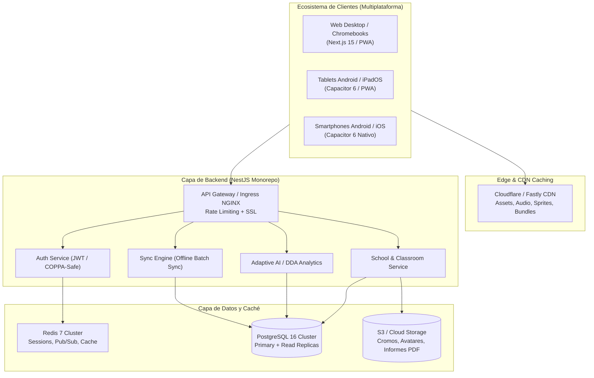
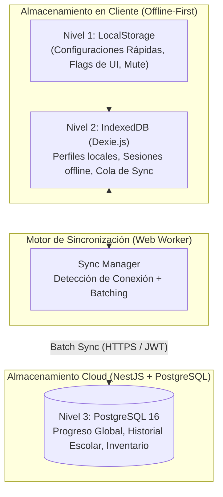
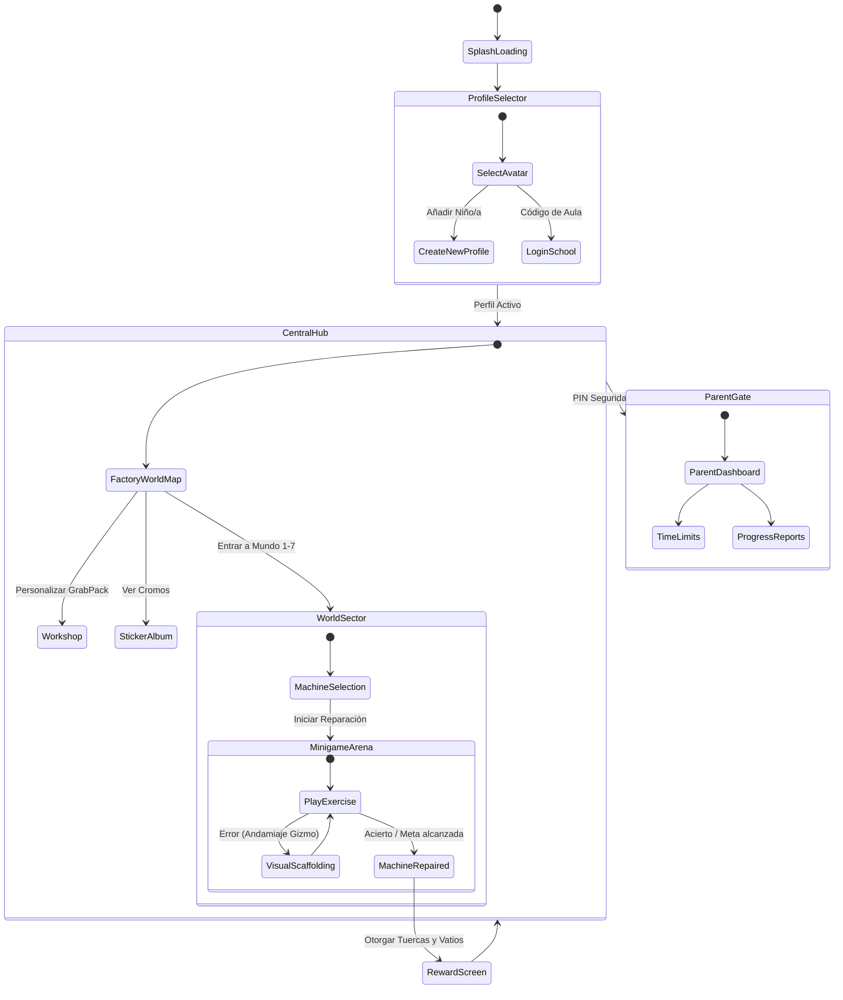

# ARQUITECTURA TÉCNICA WEB + APP - FÁBRICA DE MATES
**Versión:** 1.0.0  
**Fecha:** Noviembre 2026  
**Fase:** Fase 2 - Arquitectura Técnica y Ecosistema de Plataforma  
**Autores:** Equipo de Arquitectura (Mobile App Architect, Frontend Senior, Full Stack Architect, Lead Game Designer, Product Manager Educativo).

---

## 1. VISIÓN GENERAL DE LA ARQUITECTURA

*Fábrica de Mates* requiere una infraestructura de software **Offline-First**, de **alto rendimiento gráfico/táctil (60 FPS)** y con **sincronización multi-dispositivo sin fisuras** (colegio, hogar, tablet, smartphone y web).



---

## 2. EVALUACIÓN Y ELECCIÓN TECNOLÓGICA MOBILE: CAPACITOR vs REACT NATIVE vs FLUTTER

Uno de los requerimientos clave del proyecto es justificar técnicamente la elección de la tecnología móvil:

### 2.1. Matriz Comparativa

| Criterio | Capacitor 6 + Next.js (Web Universal) | React Native (Expo / Nitro) | Flutter 3.x (Dart / Impeller) |
| :--- | :--- | :--- | :--- |
| **Reutilización de Código** | **100% (Código único)** para Web, PWA, Android, iOS e iPadOS. | ~70-80% (Divergencia entre Web y Native DOM). | 0% con el stack React/Web (requiere dos equipos: Dart + TS). |
| **Rendimiento Gráfico 2D** | **60 FPS constantes** con Canvas2D / WebGL / CSS Hardware Acceleration. | Excelente en vistas nativas, overhead en puentes de animación intensa. | Excepcional (Impeller nativo directo a GPU). |
| **Lógica Matemática Compartida** | **100% idéntica** (los generadores C-P-A y el motor DDA corren en el mismo package). | Compartible mediante monorepo TS. | Debe reimplementarse o compilarse a WebAssembly/C++. |
| **Despliegue Educativo (PWA)** | **Nativo y directo**; el mismo bundle compila a PWA y a APK/IPA. | PWA soportada pero secundaria y pesada. | WebAssembly grande (+15 MB iniciales), carga lenta en aulas. |
| **Coste y Tiempo de Mantenimiento** | **Bajo** (Un solo equipo Frontend/Fullstack domina todo el ciclo). | Medio (Puentes nativos específicos, mantenimiento de dependencias duales). | Alto (Duplicidad de stack, dos lenguajes: TypeScript + Dart). |

### 2.2. Decisión Arquitectónica Justificada
Se adopta la arquitectura **Universal Web + Capacitor 6**:
1. **Un solo código fuente, cinco destinos:** El mismo código React 19 / TypeScript corre en navegadores de escritorio, Chromebooks educativos, iPads de aula, tablets Android y smartphones iOS/Android empaquetados como binarios nativos para Google Play y Apple App Store.
2. **Cero lag en manipulación matemática:** Las mecánicas del juego (llevadas interactivas, cintas transportadoras, arrastrar tuercas) utilizan animaciones CSS transformadas por GPU y Canvas HTML5, garantizando fluidez absoluta en hardware modesto de colegios.
3. **PWA First-Class:** La distribución web en centros escolares no requiere pasar por tiendas de aplicaciones, permitiendo instalación directa en pantalla de inicio con soporte 100% offline.

---

## 3. ESTRUCTURA DEL MONOREPO (TURBOREPO)

Para mantener una arquitectura modular, escalable y mantenible, el proyecto se organiza como un monorepo gestionado con **Turborepo** y **pnpm**:

```
fabrica-de-mates/
├── apps/
│   ├── web/                     # Aplicación Next.js 15 (Web, PWA y cliente interactivo)
│   ├── mobile/                  # Shell Capacitor 6 (Android Studio & Xcode projects)
│   ├── api/                     # Backend NestJS (REST, WebSockets, Cron jobs)
│   └── docs-portal/             # Portal de documentación pedagógica y guías docentes
│
├── packages/
│   ├── game-core/               # Motor lógico de matemáticas, generador C-P-A y reglas
│   ├── adaptive-ai/             # Motor de DDA (Dynamic Difficulty Adjustment) y telemetría
│   ├── ui-kit/                  # Componentes táctiles infantiles, botones grandes, temas
│   ├── db-schema/               # Modelos Prisma/Drizzle para PostgreSQL y migraciones
│   ├── offline-sync/            # Engine Dexie.js (IndexedDB) y cliente de sincronización
│   ├── tsconfig/                # Configuraciones TypeScript compartidas
│   └── eslint-config/           # Reglas de linter y calidad de código
│
├── docs/                        # Documentación técnica y de diseño (GDD, Arquitectura, UX)
└── Playtime-fabrica-de-mates.html # Prototipo de referencia (MVP 0.1)
```

### 3.1. Responsabilidades de los Paquetes Clave

#### `packages/game-core`
Contiene la lógica pura matemática sin dependencias visuales:
* **Generadores de Operaciones:** Algoritmos deterministas que generan sumas con/sin llevada, restas con préstamos descompuestos, matrices multiplicativas, etc., garantizando valores dentro de los límites curriculares.
* **Validador de Respuestas:** Verifica no solo el resultado final, sino los pasos intermedios (ej: si la casilla de llevada fue anotada correctamente antes de responder).

#### `packages/adaptive-ai`
* Procesa los eventos de telemetría emitidos por el juego.
* Calcula el índice de fatiga y la carga cognitiva.
* Retorna la configuración de andamiaje visual requerida para el siguiente ejercicio.

#### `packages/offline-sync`
* Abstracción sobre **IndexedDB** mediante `Dexie.js`.
* Gestiona la cola de transacciones locales pendientes de sincronizar con el backend.

---

## 4. ESTRATEGIA DE PERSISTENCIA Y SINCRONIZACIÓN EN 3 NIVELES



### 4.1. Nivel 1: LocalStorage (Configuraciones Efímeras)
* **Datos guardados:** ID del perfil activo actual, ajustes de sonido (volumen música/FX), selector de modo daltónico, idioma seleccionado, flag de primera visita (`hasCompletedTutorial`).
* **Justificación:** Acceso síncrono ultra-rápido en el arranque de la app antes de montar el árbol React.

### 4.2. Nivel 2: IndexedDB con Dexie.js (Almacenamiento Robusto Offline)
* **Tablas locales:**
  * `profiles`: Alumnos en este dispositivo con sus avatares y nivel.
  * `game_progress`: Mundos y máquinas desbloqueadas localmente.
  * `inventory`: Skins del GrabPack y pegatinas desbloqueadas.
  * `sync_queue`: Lista de eventos de ejercicios completados pendientes de subir al servidor con timestamps UTC.
* **Justificación:** Capacidad de almacenamiento superior a 50 MB, transacciones asíncronas y soporte de consultas indexadas sin bloquear el hilo principal de renderizado.

### 4.3. Nivel 3: Backend Cloud (PostgreSQL + Sincronización Resiliente)
* **Protocolo de Sincronización:**
  * No se realiza una petición HTTP por cada suma o resta (lo que saturaría la red en aulas con 30 alumnos simultáneos).
  * Los ejercicios se acumulan localmente y se empaquetan en un **Sync Batch** al terminar una máquina o cada 60 segundos.
  * El endpoint `POST /api/v1/sync/batch` recibe un lote comprimido de eventos.
* **Resolución de Conflictos:**
  * Principio **"Highest Mastery & Union of Unlocks"**: Si un alumno juega en la tablet del colegio y luego en el móvil familiar sin conexión:
    * El progreso de niveles y mundos se resuelve por el valor máximo alcanzado (`Math.max(localLevel, remoteLevel)`).
    * El inventario y monedas se resuelven mediante la unión de conjuntos de ítems desbloqueados.
    * Los eventos de telemetría conservan su timestamp original y se agregan cronológicamente sin sobrescribirse.

---

## 5. MAPA DE NAVEGACIÓN Y FLUJO DE EXPERIENCIA (UX FLOW)



### 5.1. Flujo Infantil (Cero Fricción)
1. **Acceso Inmediato:** No requiere escribir contraseñas alfabéticas complejas. El niño pulsa su avatar ilustrado o introduce un código visual de 4 iconos (ej: *Estrella - Tuerca - Cohete - Robot*).
2. **Mapa de la Fábrica:** Vista isométrica interactiva que muestra las 7 naves industriales. Las naves reparadas emiten luz y vapor dorado; las averiadas tienen chispas amigables.
3. **La Arena de Minijuegos:** Interfaz limpia sin barras del navegador (fullscreen/PWA) con el GrabPack accesible en la parte inferior y las máquinas en el centro.

### 5.2. Pasarela de Adultos (Parent Gate)
Para acceder a la configuración, soporte o paneles de padres, se exige resolver un desafío de seguridad que un niño de 3 a 8 años no pueda saltar por azar (ej: *"Desliza tres dedos hacia arriba y escribe el resultado de: setenta y cuatro menos dieciocho escrito en palabras"*).

---

## 6. MODELO DE DATOS RELACIONAL (POSTGRESQL / PRISMA SCHEMA)

```mermaid
erDiagram
    USERS ||--o{ STUDENTS : "gestiona (padre/profesor)"
    CLASSROOMS ||--o{ STUDENTS : "contiene alumnos"
    STUDENTS ||--o{ GAME_SESSIONS : "juega"
    STUDENTS ||--o{ STUDENT_INVENTORY : "posee"
    STUDENTS ||--o{ COMPETENCY_MASTERY : "domina"
    GAME_SESSIONS ||--o{ EXERCISE_ATTEMPTS : "registra eventos"

    USERS {
        uuid id PK
        string email
        string password_hash
        enum role "PARENT | TEACHER | ADMIN"
        timestamp created_at
    }

    CLASSROOMS {
        uuid id PK
        uuid teacher_id FK
        string name
        string access_code "ej. MATES6"
        string grade_level "2_PRIMARIA"
    }

    STUDENTS {
        uuid id PK
        uuid parent_id FK
        uuid classroom_id FK
        string nickname
        json avatar_config
        int total_energy_watts
        int coins_balance
        int current_engineer_level
    }

    GAME_SESSIONS {
        uuid id PK
        uuid student_id FK
        int world_id
        int minigame_id
        int duration_seconds
        timestamp started_at
    }

    EXERCISE_ATTEMPTS {
        uuid id PK
        uuid session_id FK
        string operation_type "SUMA_LLEVADA | RESTA_PRESTAMO"
        json operands "{\"a\": 248, \"b\": 175}"
        int student_answer
        int correct_answer
        boolean is_correct
        int response_time_ms
        boolean carryover_used
        string error_category "CARRYOVER_ERROR | ARITHMETIC_ERROR"
        timestamp created_at
    }

    STUDENT_INVENTORY {
        uuid id PK
        uuid student_id FK
        string item_type "GRABPACK_SKIN | STICKER | PET"
        string item_id "HAND_GOLD | PET_CHISPA"
        timestamp unlocked_at
    }

    COMPETENCY_MASTERY {
        uuid id PK
        uuid student_id FK
        string competency_code "NUM_ADD_CARRY_2DIG"
        float mastery_score "0.0 a 1.0"
        timestamp updated_at
    }
```

---

## 7. PLAN DE ESCALABILIDAD PARA 100.000 USUARIOS CONCURRENTES

### 7.1. Análisis de Carga
* **100.000 alumnos concurrentes** en hora punta escolar (ej. 10:00 AM - 12:00 PM).
* Si cada alumno realizara 1 petición HTTP por operación cada 10 segundos, tendríamos **10.000 peticiones/segundo (RPS)** al backend.
* **Solución de Optimización:** Con la arquitectura **Offline-First + Batch Sync**:
  * Las operaciones se resuelven y validan localmente en el cliente (0 llamadas de red durante el juego activo).
  * El cliente sincroniza un lote consolidado cada 60 segundos o al completar la máquina.
  * **Carga de red reducida en un 95%:** de 10.000 RPS a **~500 - 800 RPS** en el backend.

### 7.2. Estrategia de Infraestructura y Despliegue

```
┌────────────────────────────────────────────────────────────────────────┐
│                        INFRAESTRUCTURA CLOUD                           │
├─────────────────────┬──────────────────────────────────────────────────┤
│ Capa CDN Edge       │ Cloudflare Enterprise con Cloudflare Workers.    │
│                     │ 99.5% de tráfico estático (imágenes, audios y    │
│                     │ bundles Next.js) servido desde caché perimetral. │
├─────────────────────┼──────────────────────────────────────────────────┤
│ Cómputo Backend     │ Clúster Kubernetes (EKS / GKE) con Auto-scaling  │
│                     │ horizontal (HPA) de pods NestJS de 4 a 24 nodos. │
├─────────────────────┼──────────────────────────────────────────────────┤
│ Caché Distribuida   │ Clúster Redis Sentinel (en memoria) para tokens  │
│                     │ JWT, rate limiting y sesiones activas.           │
├─────────────────────┼──────────────────────────────────────────────────┤
│ Base de Datos       │ PostgreSQL gestionado (AWS Aurora / Cloud SQL)   │
│                     │ con 1 nodo Writer y 3 Read Replicas dedicadas.    │
├─────────────────────┼──────────────────────────────────────────────────┤
│ Particionado        │ Tabla `EXERCISE_ATTEMPTS` particionada por mes   │
│                     │ (Range Partitioning) para consultas analíticas.  │
└─────────────────────┴──────────────────────────────────────────────────┘
```

---

## 8. SEGURIDAD Y PRIVACIDAD INFANTIL (COPPA & GDPR-K COMPLIANCE)

1. **Sin Almacenamiento de Datos Personales Identificables (PII) de Menores:**
   * Los alumnos no se registran con su nombre real ni con correo electrónico.
   * Se utilizan alias/apodos lúdicos (ej: *"RobotVeloz42"*, *"IngenieraTuerca"*).
2. **Cero Rastreadores de Publicidad:**
   * Prohibición absoluta de Google Analytics invasivo, Facebook Pixel o SDKs de anuncios.
   * La telemetría es 100% propia, interna y estrictamente orientada al aprendizaje matemático adaptativo.
3. **Cifrado Integral:**
   * TLS 1.3 en todas las comunicaciones en tránsito.
   * AES-256 para almacenamiento de credenciales y tokens en base de datos.

---

## 9. CRITERIOS DE ACEPTACIÓN DE LA FASE 2

Para dar por aprobada la Fase 2 y continuar a la **Fase 3: Diseño UX/UI**, se valida:
* [x] Elección técnica de Mobile justificada y consensuada (Capacitor + Next.js).
* [x] Estructura modular del Monorepo (Turborepo).
* [x] Estrategia de persistencia en 3 niveles (LocalStorage, IndexedDB/Dexie, PostgreSQL).
* [x] Mapa de navegación completo (alumno, familias y colegios).
* [x] Modelo de datos relacional y plan de escalabilidad para 100.000 usuarios.
