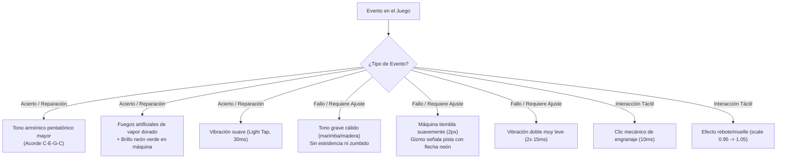

# DISEÑO UX/UI Y SISTEMA DE DISEÑO - FÁBRICA DE MATES
**Versión:** 1.0.0  
**Fecha:** Noviembre 2026  
**Fase:** Fase 3 - Diseño UX/UI, Wireframes y Accesibilidad Infantil  
**Autores:** Equipo de Experiencia de Usuario (UX/UI Designer Infantil, Especialista en Accesibilidad WCAG, Psicopedagogo 3-12 años, Lead Game Designer, Frontend Senior Developer).

---

## 1. PRINCIPIOS DE DISEÑO CENTRADO EN LA INFANCIA (KID-CENTERED DESIGN)

El diseño visual y de interacción de *Fábrica de Mates* se rige por cinco principios de ergonomía física y cognitiva adaptada a niños y niñas de 3 a 12 años:

```
┌────────────────────────────────────────────────────────────────────────┐
│               PRINCIPIOS DE DISEÑO INFANTIL (UX/UI)                    │
├─────────────────────┬──────────────────────────────────────────────────┤
│ 1. Ergonomía Táctil │ Botones sobredimensionados (≥ 56-64 px) con      │
│                     │ generoso margen (≥ 12 px) para evitar toques     │
│                     │ accidentales por motricidad fina en desarrollo.  │
├─────────────────────┼──────────────────────────────────────────────────┤
│ 2. Cero Penalización│ El error es exploratorio: la máquina "tose vapor"│
│    Sensorial        │ amigablemente; no hay zumbidos estridentes,      │
│                     │ parpadeos en rojo ni vibraciones aversivas.      │
├─────────────────────┼──────────────────────────────────────────────────┤
│ 3. Doble            │ La información crítica nunca depende solo del    │
│    Codificación     │ color: se acompaña siempre de formas geométricas,│
│                     │ texturas y retroalimentación auditiva/háptica.   │
├─────────────────────┼──────────────────────────────────────────────────┤
│ 4. Autonomía        │ Toda instrucción textual dispone de locución     │
│    Lectora (Audio)  │ clara por voz; niños prelectores (3-5 años)      │
│                     │ pueden jugar mediante iconografía intuitiva.     │
├─────────────────────┼──────────────────────────────────────────────────┤
│ 5. Estado de Flujo  │ Animaciones orgánicas a 60 FPS, microinterac-    │
│    sin Distracción  │ ciones táctiles gratificantes (efecto "muelle",   │
│                     │ arrastre magnético) y foco visual centralizado.  │
└─────────────────────┴──────────────────────────────────────────────────┘
```

---

## 2. DESIGN SYSTEM INFANTIL ("TOY FACTORY DESIGN TOKENS")

### 2.1. Paleta Cromática y Niveles de Contraste (WCAG 2.2 AA)
La paleta combina una base industrial oscura y acogedora (que evita la fatiga visual en sesiones prolongadas) con colores de acento neón de alto impacto:

```css
:root {
  /* Fondos y Superficies Industriales */
  --bg-primary: #070C1F;       /* Índigo profundo (fondo de pantalla general) */
  --bg-surface: #0A1330;       /* Azul taller (tarjetas, contenedores de máquinas) */
  --bg-surface-raised: #0F1D4A;/* Superficie elevada (modales, cabecera HUD) */
  --border-industrial: #1C3B7A;/* Bordes metálicos de separación */

  /* Acentos de Energía Neón (Contraste verificado ≥ 4.5:1) */
  --neon-blue: #19A7FF;        /* Color principal: Manos GrabPack, energía, enlaces */
  --neon-pink: #FF3FA4;        /* Manos secundarias, llevadas interactivas, alertas suaves */
  --neon-yellow: #FFD23F;      /* Monedas de oro, estrellas, llamadas a la acción */
  --neon-green: #2DFF7A;       /* Éxito, reparación completada, avance */
  --neon-orange: #FF8A00;      /* Advertencias de vapor, advertencias pedagógicas */

  /* Textos y Lectura */
  --text-primary: #EAF6FF;     /* Blanco nieve con matiz azulado (máxima legibilidad) */
  --text-secondary: #9DB4D6;   /* Texto secundario, descripciones breves */
  --text-muted: #5A74A0;       /* Etiquetas técnicas inactivas */
  --text-dark: #17203A;        /* Texto oscuro sobre fondos amarillos/blancos */
}
```

### 2.2. Modos de Accesibilidad Daltónica (Doble Codificación)
Para garantizar la inclusión de niños con daltonismo (afecta al ~8% de niños varones), los elementos funcionales combinan color con geometrías y texturas exclusivas:

| Canal Funcional | Modo Estándar | Protanopia / Deuteranopia | Tritanopia | Codificación Geométrica / Textura |
| :--- | :--- | :--- | :--- | :--- |
| **Columna Unidades** | Neón Azul (`#19A7FF`) | Azul Cobalto (`#1565C0`) | Cian Vivo (`#00BCD4`) | Círculo punteado $\bigcirc$ |
| **Columna Decenas** | Neón Rosa (`#FF3FA4`) | Ámbar Brillante (`#FFA000`) | Magenta Suave (`#D81B60`) | Cuadrado rayado $\Box$ |
| **Columna Centenas** | Neón Amarillo (`#FFD23F`) | Blanco Hielo (`#FFFFFF`) | Naranja Claro (`#FB8C00`) | Triángulo equilátero $\triangle$ |
| **Acierto / Reparado** | Neón Verde (`#2DFF7A`) | Azul Turquesa (`#00E5FF`) | Verde Esmeralda (`#00C853`) | Icono Engranaje Girando + Tono Dulce |
| **Requiere Ajuste** | Chispa Naranja (`#FF8A00`) | Violeta Profundo (`#6200EA`) | Rojo Oscuro (`#C62828`) | Icono Nube de Vapor + Tono Bajo |

### 2.3. Tipografía y Escalas Adaptadas
Se combinan dos familias tipográficas de Google Fonts con licencia abierta:
* **Titulares y Cifras Matemáticas:** `Baloo 2` (pesos 700 y 800). Rasgos redondeados, formas acogedoras y diferenciación radical entre números conflictivos ($1$ con serif marcada vs $7$ con travesaño, $6$ y $9$ con bucles bien diferenciados).
* **Textos de Interfaz y Enunciados:** `Quicksand` (pesos 500 y 700). Alta legibilidad geométrica, altura de la 'x' elevada y excelente rendimiento en pantallas pequeñas.

```css
/* Escala Tipográfica Fluida (CSS clamp) */
--font-math-giant: clamp(2.5rem, 8vw, 4.5rem);   /* Cifras de operaciones verticales */
--font-heading-1:  clamp(1.8rem, 6vw, 2.8rem);   /* Título de sala / máquina */
--font-heading-2:  clamp(1.3rem, 4vw, 2.0rem);   /* Títulos de tarjetas y modales */
--font-body:       clamp(1.0rem, 2.8vw, 1.3rem); /* Enunciados e instrucciones */
--font-caption:    clamp(0.85rem, 2.2vw, 1.0rem);/* Etiquetas secundarias */
```

### 2.4. Componentes UI Base y Dimensiones Físicas

```
┌────────────────────────────────────────────────────────────────────────┐
│                    DIMENSIONES TÁCTILES ESTÁNDAR                       │
├─────────────────────┬──────────────────────────────────────────────────┤
│ Botón Principal     │ Alto: 64 px | Radio: 32 px (Píldora)             │
│                     │ Sombra 3D: border-bottom de 6 px para simular    │
│                     │ pulsador físico mecánico de juguete.             │
├─────────────────────┼──────────────────────────────────────────────────┤
│ Casilla de Llevada  │ Diámetro: 48 px | Borde discontinuo de 3 px      │
│                     │ Animación de pulsación suave (efecto respiración)│
├─────────────────────┼──────────────────────────────────────────────────┤
│ Botón de Opción     │ Ancho: mín 110 px | Alto: mín 72 px               │
│                     │ Tipografía: 2.2 rem negrita centrada             │
├─────────────────────┼──────────────────────────────────────────────────┤
│ Control GrabPack    │ Manos interactivas: 64 x 64 px flotantes         │
│                     │ Cable con efecto de resorte elástico (SVG)       │
└─────────────────────┴──────────────────────────────────────────────────┘
```

---

## 3. WIREFRAMES Y ESQUEMAS DE INTERFAZ (ASCII MOCKUPS)

### 3.1. Pantalla 1: Selector de Perfil Infantil y Acceso Escolar

```
+------------------------------------------------------------------------+
| [?] Ayuda Sonora (TTS)                 FÁBRICA DE MATES        [Engranaje] Config |
+------------------------------------------------------------------------+
|                                                                        |
|                       ¿QUIÉN VA A REPARAR HOY?                         |
|                                                                        |
|      +----------------+   +----------------+   +----------------+      |
|      |   ( *   * )    |   |     \ O /      |   |     [+]        |      |
|      |    \ === /     |   |      [X]       |   |   AÑADIR       |      |
|      |   [Mecanoide]  |   |    [Lucía]     |   |   PERFIL       |      |
|      |   Nivel 4 ★    |   |   Nivel 2 ★    |   |                |      |
|      +----------------+   +----------------+   +----------------+      |
|                                                                        |
|  --------------------------------------------------------------------  |
|                                                                        |
|     [🏫 ¿Tienes código de tu Cole?]   Ej: [ M ] [ A ] [ T ] [ E ] [ 6 ] |
|                                                                        |
|  [ 👨‍👩‍👧 Panel de Padres / Profes ] ---> Protegido por Desafío Adulto      |
+------------------------------------------------------------------------+
```

### 3.2. Pantalla 2: Mapa Central de la Fábrica (Central Hub)

```
+------------------------------------------------------------------------+
| [<- Salir]  [🪙 350 Tuercas]   [⚡ Nivel 5: 1.250 Vatios]   [🔊 Sonido ON] |
+------------------------------------------------------------------------+
|                                                                        |
|    MUNDO 1:           MUNDO 2:              MUNDO 3:                   |
|  [Sala Números]     [Central Sumas]       [Lab. Restas]                |
|      ( REPARADO )     ( EN OBRAS ⚡ )       ( BLOQUEADO 🔒 )            |
|       ⭐⭐⭐               ⭐⭐☆                  ☆☆☆                    |
|          |                   |                                         |
|          +===================+=======> [Línea de Vapor Activa]          |
|                                                                        |
|    MUNDO 4:           MUNDO 5:              MUNDO 6:          MUNDO 7: |
|  [Multiplicador]     [División]            [Fracciones]      [Lógica]  |
|    ( 🔒 Bloq )        ( 🔒 Bloq )           ( 🔒 Bloq )       ( 🔒 Bloq)|
|                                                                        |
|------------------------------------------------------------------------|
|  [ 🎒 Taller GrabPack ]     [ 📖 Álbum Cromos ]     [ 🛒 Juguetería ]  |
+------------------------------------------------------------------------+
```

### 3.3. Pantalla 3: Arena de Minijuego - Operación Vertical con Llevadas (Mundo 2 / MVP Core)

```
+------------------------------------------------------------------------+
| [<- Volver]  Máquina #3: Generador de Turbina      [🪙 350]  [♥♥♥ Batería] |
+------------------------------------------------------------------------+
|                                                                        |
|    +---------------------+         +-----------------------------+     |
|    |      GIZMO          |         |    [?] Casilla de Llevada   |     |
|    |   ( ^ _ ^ )         |         |     C      D      U         |     |
|    | "¡Suma las unidades |         |           ( 1 )             | <-- Pulsable
|    |  y sube la decena!" |         |      2     4      8         |     |
|    +---------------------+         |  +   1     7      5         |     |
|                                    | --------------------------- |     |
|                                    |      4     2     [ ? ]      |     |
|                                    +-----------------------------+     |
|                                                                        |
|  --------------------------------------------------------------------  |
|  OPCIONES DE ENERGÍA (Toca la correcta con el GrabPack):               |
|                                                                        |
|       +--------------+     +--------------+     +--------------+       |
|       |    [ 3 ]     |     |    [ 13 ]    |     |    [ 4 ]     |       |
|       |  Cable Azul  |     |  Cable Rosa  |     |  Cable Verde |       |
|       +--------------+     +--------------+     +--------------+       |
|                                                                        |
|          [ ✋ Mano Azul ]                      [ ✋ Mano Rosa ]         |
+------------------------------------------------------------------------+
```

### 3.4. Pantalla 4: Pantalla de Reparación Exitosa (Feedback y Recompensas)

```
+------------------------------------------------------------------------+
|                                                                        |
|                  🎉 ¡MÁQUINA REPARADA CON ÉXITO! 🎉                   |
|                                                                        |
|                          [ GENERADOR ACTIVO ]                          |
|                       * Sonido de vapor triunfal *                     |
|                                                                        |
|                +---------------------------------------+               |
|                |  ⭐ Precisión: 100%                   |               |
|                |  ⚡ Energía Ganada: +150 Vatios        |               |
|                |  🪙 Tuercas Obtenidas: +50             |               |
|                |  🎁 ¡Cromo Desbloqueado: Ada Lovelace!|               |
|                +---------------------------------------+               |
|                                                                        |
|              [ 🔁 Jugar Otra Vez ]      [ ➡️ Siguiente Máquina ]        |
+------------------------------------------------------------------------+
```

### 3.5. Pantalla 5: Panel de Control de Padres y Docentes

```
+------------------------------------------------------------------------+
| [<- Salir al Juego]           PANEL DE SEGUIMIENTO EDUCATIVO           |
+------------------------------------------------------------------------+
| Alumno/a: [ Lucía - 2º Primaria ]                   Semana: Nov 2026   |
|                                                                        |
|  +--------------------------+  +-------------------------------------+ |
|  | TIEMPO DE APRENDIZAJE    |  | MATRIZ DE COMPETENCIAS LOMLOE       | |
|  | Total semana: 1h 45 min  |  | Sumas sin llevada:    [100%] ⭐⭐⭐ | |
|  | Media diaria: 15 min     |  | Sumas con llevada:    [ 85%] ⭐⭐⭐ | |
|  | Límite diario: [ 30 min] |  | Restas con préstamo:  [ 60%] ⭐⭐☆ | |
|  +--------------------------+  +-------------------------------------+ |
|                                                                        |
|  RECOMENDACIÓN PEDAGÓGICA AUTOMÁTICA:                                  |
|  "Lucía domina la suma vertical. Recomendamos reforzar el concepto de  |
|   descomposición de decenas en las restas del Mundo 3."                |
|                                                                        |
|  [ 📄 Exportar Informe PDF para Cole ]      [ 🔒 Configurar Alertas ]  |
+------------------------------------------------------------------------+
```

---

## 4. SISTEMA DE RETROALIMENTACIÓN MULTISENSORIAL



---

## 5. AUDITORÍA DE ACCESIBILIDAD Y CONFORMIDAD WCAG 2.2 AA

| Criterio WCAG 2.2 | Nivel | Implementación Específica en Fábrica de Mates |
| :--- | :---: | :--- |
| **1.1.1 Contenido No Textual** | A | Todo sprite, robot o indicador matemático dispone de `aria-label` descriptivo (ej: `aria-label="Casilla de llevada: 1 decena anotada"`). |
| **1.4.1 Uso del Color** | A | Doble codificación estricta: formas geométricas distintas para centenas, decenas y unidades; texturas rayadas y punteadas. |
| **1.4.3 Contraste Mínimo** | AA | Todo texto sobre fondo cumple ratio $\ge 4.5:1$ (validado: `#EAF6FF` sobre `#070C1F` tiene ratio $14.2:1$). |
| **1.4.4 Cambio de Tamaño del Texto**| AA | La interfaz soporta zoom al 200% sin romper el layout mediante unidades relativas (`rem`, `clamp` y Flexbox/Grid). |
| **2.1.1 Acceso por Teclado** | A | Navegación completa mediante tabulación (`Tab`, `Shift+Tab`, `Enter`, `Espacio`) y teclas numéricas del 0 al 9. |
| **2.1.4 Atajos de un Solo Carácter** | A | Desactivables o reasignables para evitar activaciones no deseadas por pulsaciones erróneas. |
| **2.2.2 Pausar, Detener, Ocultar** | A | Cintas transportadoras y animaciones disponen de botón de pausa instantáneo; respeto a `prefers-reduced-motion`. |
| **2.5.5 Tamaño del Objetivo Táctil** | AAA | Objetivos de pulsación $\ge 56 \times 56\text{ px}$ (supera el estándar AA de 24x24 px y cumple el estándar infantil de 48-64 px). |
| **3.3.1 Identificación de Errores** | A | Gizmo describe el error de forma constructiva mediante texto y audio narrado sin lenguaje intimidatorio. |

---

## 6. CONFIGURACIÓN TÉCNICA DE DESIGN TOKENS (TAILWIND CSS)

Para su integración directa en el paquete compartido `packages/ui-kit` en las fases de código:

```typescript
// packages/ui-kit/tailwind.config.ts
import type { Config } from 'tailwindcss';

const config: Config = {
  content: ['./src/**/*.{ts,tsx}', '../../apps/**/*.{ts,tsx}'],
  theme: {
    extend: {
      colors: {
        factory: {
          bg: '#070C1F',
          surface: '#0A1330',
          surfaceRaised: '#0F1D4A',
          border: '#1C3B7A',
        },
        neon: {
          blue: '#19A7FF',
          pink: '#FF3FA4',
          yellow: '#FFD23F',
          green: '#2DFF7A',
          orange: '#FF8A00',
        },
        math: {
          units: '#19A7FF',
          tens: '#FF3FA4',
          hundreds: '#FFD23F',
        }
      },
      fontFamily: {
        math: ['"Baloo 2"', 'cursive', 'sans-serif'],
        sans: ['Quicksand', 'sans-serif'],
      },
      minHeight: {
        touch: '56px',
        touchLarge: '64px',
      },
      minWidth: {
        touch: '56px',
        touchLarge: '64px',
      },
      boxShadow: {
        'neon-blue': '0 0 16px rgba(25, 167, 255, 0.45)',
        'neon-pink': '0 0 16px rgba(255, 63, 164, 0.45)',
        'neon-green': '0 0 18px rgba(45, 255, 122, 0.5)',
        'btn-3d': '0 6px 0 #0A3A82',
        'btn-3d-active': '0 2px 0 #0A3A82',
      }
    },
  },
  plugins: [],
};

export default config;
```

---

## 7. CRITERIOS DE ACEPTACIÓN DE LA FASE 3

Para dar por aprobada la Fase 3 y avanzar a la **Fase 4: Backend y Sincronización**, se verifica:
* [x] Definición completa de Design Tokens (colores, fuentes, espaciados y dimensiones táctiles infantiles).
* [x] Wireframes y maquetas estructurales de las 5 pantallas neurálgicas del producto.
* [x] Cumplimiento normativo estricto de accesibilidad WCAG 2.2 AA y modos daltónicos con doble codificación.
* [x] Arquitectura de retroalimentación multisensorial libre de ansiedad y castigos.
* [x] Exportación técnica de tokens lista para Tailwind CSS en `packages/ui-kit`.
